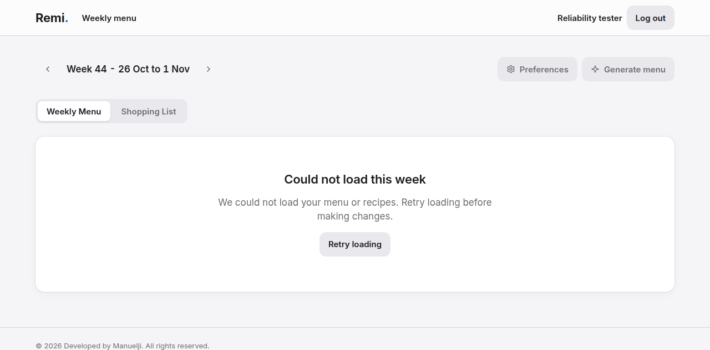
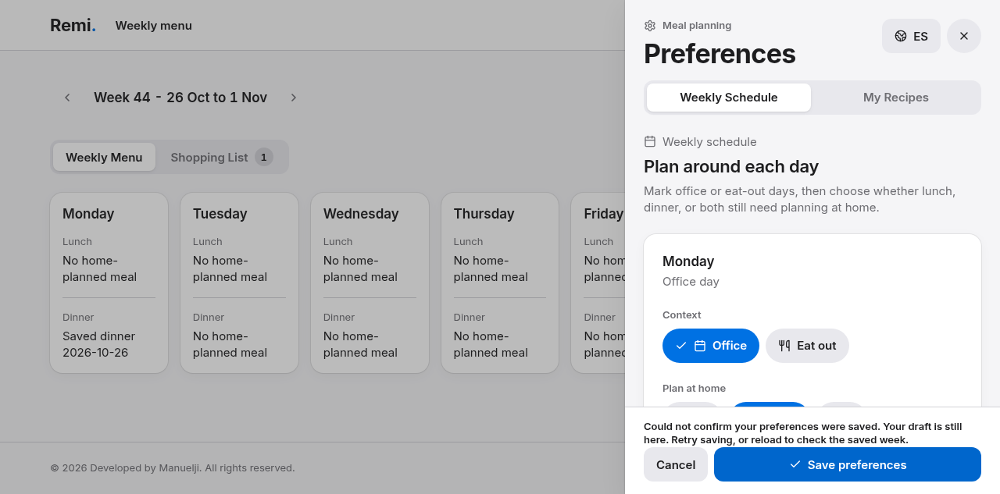

# Planner reliability verification results

## Final verification

- Production build based on main commit `82e7f84`, with this PR's frontend changes, served at the isolated address `http://127.0.0.1:3101`.
- Chrome browser regression: **14/14 scenarios passed**, using `planner-reliability.init.js` and the assertions in `planner-reliability.browser.js` through native `agent_browser_code`.
- [Machine-readable results](artifacts/results.json) record each scenario's verdict.
- `pnpm --dir frontend typecheck`: passed.
- `pnpm --dir frontend lint`: passed without warnings.
- `pnpm --dir frontend check`: passed.
- `pnpm --dir frontend test`: **38 passed, one skipped**. The skipped recipe-store test requires `RECIPE_DATABASE_TESTS=1` and a configured database.
- `pnpm --dir frontend build`: passed; existing dependency-level `use client` bundling warnings remain.
- `git diff --check`: passed.
- `pnpx react-doctor@latest`: **not clean** (44/100; two existing render-time scroll-ref mutation errors in `PreferencesPanel.tsx`, plus repository-wide warnings including generated `.output` dependencies). The new request-identity ref is updated in a layout effect, not during render. Remaining findings are tracked in the TODO and were not bundled into this reliability fix.

The scenarios cover failed initial reads, safe retry, pending authentication/menu reads, recipe/prior-week generation failures before POST, generation POST failure/retry, retained schedule drafts, guarded pending saves, late successful/failed reads, sign-out before/after a generation POST, recipe-catalog recovery, first generation after a successful empty read, and Spanish feedback/recovery.

The original failed-read bug was reproduced before implementation: the planner displayed "No Weekly Menu yet" with enabled generation after a synthetic failed read. The final regression explicitly rejects that behavior and checks that no write occurred.

An additional unmocked guest check confirmed browser-local schedule saving and guest-grid generation; no server-function POST was captured.

## Screenshots

Both images were captured from the final isolated production build with synthetic account/recipe data. Native artifact metadata confirmed that both files existed and were verified before recording these results.

### Failed load blocks changes and offers retry

### Failed schedule save retains the draft and offers another save

## Limits and environment notes

- Authentication and server-function responses are mocked at the browser fetch boundary. These checks establish UI failure/recovery behavior, **not** real Postgres persistence, email delivery, OTP, or server authorization. The live authenticated journey remains in the frontend TODO.
- The browser runner is repeatable with the [setup instructions](PLANNER-RELIABILITY.md); it is not wired into CI or Vitest.
- An earlier dev-server run encountered localhost/worktree isolation and readiness issues. Final evidence comes from the dedicated IPv4 production-server run above.
- Earlier Vitest workers exited under shared-host memory pressure. After shutting down this task's unused development server/browser sessions, both single-worker and normal `pnpm test` runs passed. No unrelated host processes were stopped.
